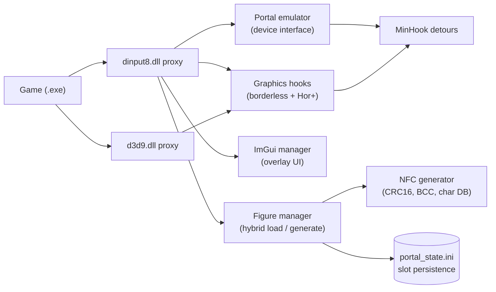

# Virtual Portal

A virtual USB portal for Skylanders-style toys-to-life figures on PC:
proxy DLLs emulate the portal hardware, generate figure data, and add
widescreen and borderless-window handling — with an in-game manager UI.

> Status: work in progress. Everything below builds cleanly; in-game
> validation (log creation, borderless/widescreen behaviour) is still open.
> Nothing here is presented as finished that isn't.

## What "virtual portal" means here

The original games talk to a USB portal peripheral to detect which toy
figure is placed on it. This project replaces that hardware in software:
a proxy `dinput8.dll` sits next to the game executable, answers the
portal's device interface, and serves figure data from local `.sky` dumps —
or generates valid figure data on the fly. A companion `d3d9.dll` proxy
adds modern display behaviour the old game never had.

## How it works



- **Portal emulation** (`src/portal/portal_emulator.cpp`) — answers the
  portal device interface so the game sees placed figures without hardware.
  Interface research was done against the original portal DLL with a
  disassembler; the observed surface is a small command set (initialize,
  query status, present/remove figure per slot). Only that interface
  behaviour is re-implemented here — no proprietary code is reproduced
  (see [Reverse-engineering notes](#reverse-engineering-notes)).
- **NFC figure generator** (`src/portal/nfc_generator.cpp`, native C++ port
  of `generate_skylander.py`) — builds valid figure dumps (CRC16, BCC,
  character database). Hybrid loading: if a dump file exists it is loaded,
  otherwise one is generated and saved.
- **Figure manager** (`src/portal/figure_manager.cpp`) — buffered I/O with
  a 30-second flush thread so gameplay never hammers the disk; dirty
  buffers are flushed and slot state saved on DLL detach.
- **Manager UI** (`src/portal/imgui_manager.cpp`) — Dear ImGui card-based
  "Virtual Portal Manager" overlay (`INSERT` toggle, slot cards, character
  selector modal).
- **Graphics hooks** (`src/portal/graphics_hooks.cpp`) — MinHook detours on
  `Direct3DCreate9` / `CreateDevice` / `Reset` / `SetTransform`
  (projection-matrix path) for borderless-window enforcement, resolution
  override, and Hor+ aspect-ratio correction.

## Project layout

```text
src/
  common/    logging, INI config provider, portal-state persistence
  portal/    dinput8 proxy, portal emulator, NFC generator,
             figure manager, ImGui manager, hook manager
  graphics/  d3d9 proxy, graphics hooks, DLL entry points
deps/
  MinHook/   API-hooking library (vendored, BSD — see LICENSE.txt)
  imgui/     overlay UI library (git submodule, MIT)
analyze.py / check_blocks.py / generate_skylander.py   dump helpers
portal_config.ini   portal + graphics toggles (safe template)
figures/            LOCAL ONLY — your figure dumps (git-ignored)
```

## Requirements

- CMake `>= 3.20`
- A **32-bit (x86) toolchain** — the build refuses 64-bit generators
- Git with submodule support
- Your own legally obtained copy of the game (not included, obviously)

## Build

```sh
git submodule update --init --recursive
cmake -S . -B build -A Win32
cmake --build build --config Release
```

This produces `dinput8.dll` and `d3d9.dll`. Copy them next to the game
executable and tune `portal_config.ini`:

```ini
[portal]
debug_log = true

[figures]
slot_0 = figures\spyro.sky

[graphics]
widescreen_fix = true
borderless_window = true
```

## Verification

There is no automated test suite yet. Current verification:

- `analyze.py` / `check_blocks.py` — figure-dump sanity checks
- Both DLL targets compile cleanly
- Open: launch the game, confirm both `.log` files appear, verify
  borderless/widescreen behaviour

## Limitations

- 32-bit only, by design of the hooking approach.
- Version-sensitive: detours target specific Direct3D9 entry points and
  may need updating for other game builds.
- Anti-cheat-protected titles are out of scope — this is for local,
  user-owned legacy games.

## Reverse-engineering notes

`portal_disasm.txt` and `imports.txt` (disassembly/import listings of the
commercial game binaries) exist in the local working copy as analysis
scratch and are **explicitly excluded from this repository**
(`.gitignore`). What the analysis established, in our own words: the portal
DLL exposes a narrow device-command interface (init, status query,
per-slot present/remove), and the game executable imports the standard
DirectInput8/Direct3D9 entry points the proxies forward. That behavioural
understanding is what the code above implements.

## Third-party components

| Component | License | How included |
|---|---|---|
| [MinHook](https://github.com/TsudaKageyu/minhook) (Tsuda Kageyu) | BSD-style (see `deps/MinHook/LICENSE.txt`) | vendored + submodule pin |
| [Dear ImGui](https://github.com/ocornut/imgui) (Omar Cornut) | MIT | git submodule |

## Contributing

Small niche project: open an issue describing the game build and the
behaviour you see before sending changes, and keep game-specific hacks
behind config flags rather than hard-coding them.

## License

My original code in this repository is MIT-licensed — see [LICENSE](LICENSE).
MinHook and Dear ImGui retain their own licenses (above).

## Disclaimer

Unofficial fan project, not affiliated with or endorsed by Activision,
Toys for Bob, Microsoft, Nintendo, or the Cemu maintainers. You need your
own legally obtained copy of the game; no game files, dumps from
commercial titles, or keys are included.
